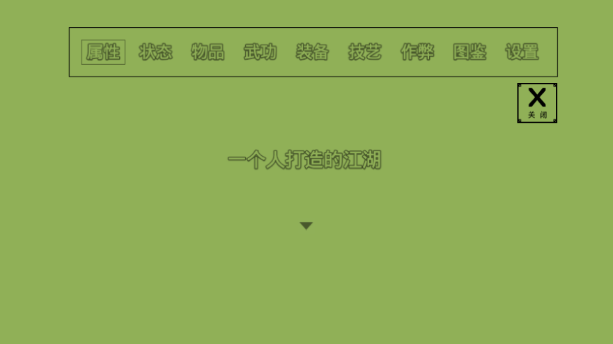
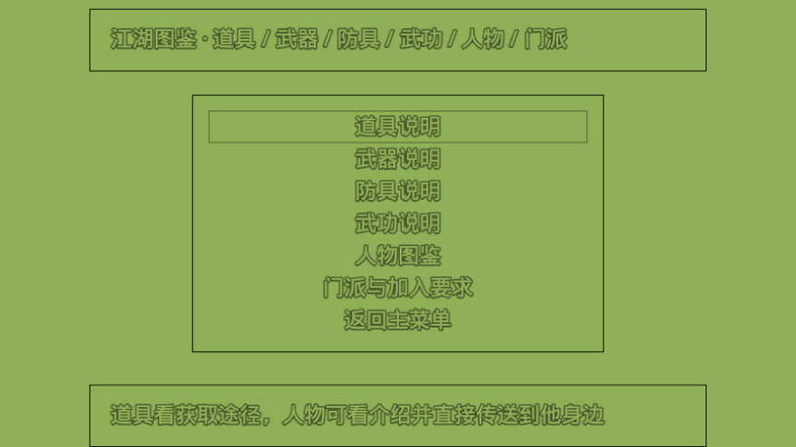
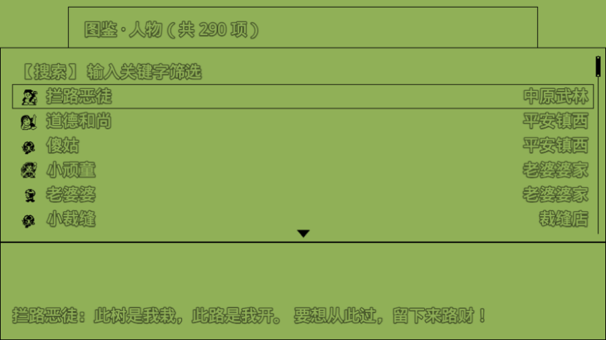
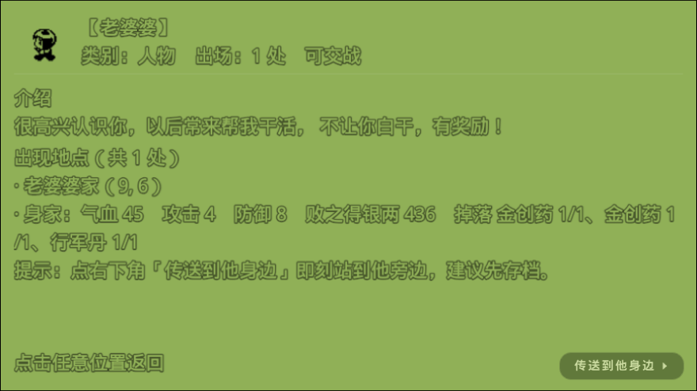
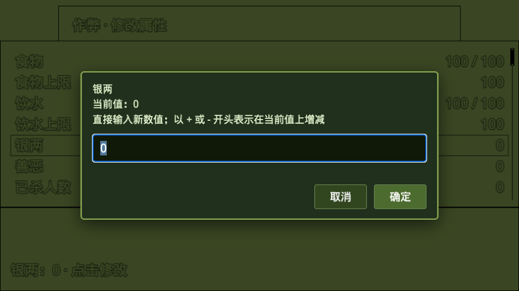
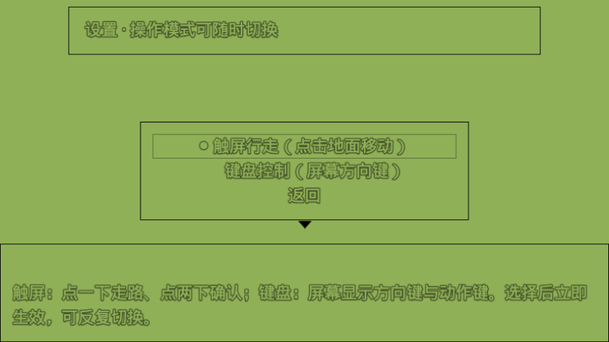

# 白金英雄坛说 · H5版

单机武侠 RPG《白金英雄坛说》的**网页单文件版**：一个 HTML 文件装下全部素材与数据，打开即玩，不需要联网、不需要安装、不需要服务器。

---

## 立即开玩

| 入口 | 地址 |
| --- | --- |
| 在线游玩 | <https://congfeng12.github.io/baijin-hero-h5/baijin-hero-h5.html> |
| 首页跳转 | <https://congfeng12.github.io/baijin-hero-h5/> |
| 离线下载 | 保存 `baijin-hero-h5.html`（约 24 MB）后双击用浏览器打开 |

推荐 Chrome / Edge / Safari 等现代浏览器；手机浏览器同样可以玩（默认就是触屏操作）。

---

## 这是个什么样的游戏

你意外得到一台古老的「文曲星」学习机，被送进一个熟悉的江湖 —— 变回 14 岁，从平安镇开始重活一次。

- **拜门派、学武功**：少林、武当、华山、日月神教等 13 个门派，各有掌门、地点与硬性收徒条件（性别、修为、善恶、江湖人缘…）。
- **练功法、配招式**：拳脚、兵刃、内功、轻功、绝学 300 多种武功，需要内力驱动，搭配对应兵器才有效。
- **跑任务、攒家当**：任务需要特定道具，掉落、商店、剧情、NPC 各有出处；银两、潜能、生活经验、善恶值都会影响走向。
- **打不过就练**：敌人会掉落、会连招、会点穴下毒；修为不够时，宝箱和任务都会明确告诉你还差什么。

---

## H5 版在原版基础上做的事

### 1. 主菜单同级新增三个入口

`属性 / 状态 / 物品 / 武功 / 装备 / 技艺` 后面并排多了 **作弊 · 图鉴 · 设置**，风格与原有卡片一致，不用翻二级菜单。

### 2. 江湖图鉴：道具 / 武器 / 防具 / 武功 / 人物 / 门派

每件东西都带**获取途径**（商店、掉落及概率、剧情、习得地点与师父），共收录道具 485、武器 123、防具 120、武功 344、人物 290、门派 13。列表支持关键字搜索，底部说明窗自动换行不再被裁切。

门派页直接把**加入要求**摊开给你看，并对照当前数值标注「已满足 / 未满足」：

### 3. 人物图鉴：一键站到任何人身边

290 位人物带**头像、名字、开场白、出现地点、身家（气血/攻击/防御/掉落）**，详情页右下角一个 **「传送到他身边」** 按钮，直接落到人物跟前并面朝他。

落点由引擎自己的通行判定兜底：如果人物正下方是柜台、墙这类碰撞体，会自动改找周围第一格能站、且不会误踩触发事件的位置，不会出现「传送过去动不了」。

### 4. 作弊：改数值、发道具、学武功

41 项数值可直接编辑（食物/饮水/银两/善恶/杀人数/实战/已完成任务/江湖人缘/武林排名/战斗力/阅历/修为/各项技艺与读书/生活经验/武艺潜能，以及主角八维），支持 `+N` / `-N` 增量输入；道具、武器、防具可按数量放进背包；武功可直接学会。

### 5. 设置：触屏 / 键盘随时切换

- **触屏行走**：点一下地面走路，点两下确认（默认）。
- **键盘控制**：屏幕显示方向键与动作键，键盘方向键 + 回车操作。

选完立即生效，可以反复来回切，不会一选定终身。

### 6. 过场可以跳过

序幕插图、滚动文字这类长演出（原版要干等十几秒）会在画面底部中间出现一个不刺眼的 **「跳过 ▸」** 按钮，点按钮或点画面任意位置都能立刻继续。

### 7. 密码宝箱点开就到手

8 个密码宝箱（新手宝箱、保险箱、6 个密码箱）不再问「要不要试」、不再弹密码框、不再贴 QQ 群 / 公众号取密码的公告；点一下直接给奖励，也**不会再因为输错密码而永久锁死**。同时全局清掉了 QQ 群号、公众号、官网下载、赞助授权、更新公告这类与玩法无关的文案。

### 8. 其他改动

- 画面按窗口**等比缩放**填满浏览器，保持比例不变形。
- 银两上限从 `8,500,000` 提升到 `999,999,999`。
- 任务对话提到需要的道具时，会自动追加一行「获取途径」提示。
- 标题画面与浏览器标签页显示「白金英雄坛说 H5版」。

---

## 存档说明

存档写在**浏览器 localStorage** 里：换浏览器、换设备、清缓存、用无痕模式都会丢档。云端相关功能（签到、兑换、会员、在线更新、云存档）依赖原作者的服务器，离线版不可用。

---

## 已知说明

- 人物图鉴只收录人形贴图上的可对话人物，个别用特殊贴图的角色（如雕像、神兵）不在列表里。
- 传送是图鉴提供的便捷功能，会直接切图，建议传送前先在游戏内保存。
- 部分剧情要求特定修为 / 生活经验才能推进，这类进度门槛保留原样，作弊面板也可以直接改。

---

## 更新记录

| 日期 | 内容 |
| --- | --- |
| 2026-10-23 | 人物传送落点自动避开碰撞体；移除宝箱与全局的 QQ 群 / 公众号 / 官网等公告文案；文件改名为 `baijin-hero-h5.html` |
| 2026-10-23 | 新增人物图鉴（头像 + 说明 + 一键传送到身边）；密码宝箱改为点开即得 |
| 2026-10-22 | 修复图鉴 / 作弊 / 设置打开报错；新增过场「跳过」按钮与触屏 / 键盘切换设置 |
| 2026-10-22 | 作弊与图鉴移到主菜单同级；新增门派加入要求页；任务对话追加获取提示；画面等比缩放；银两上限提升；标题改为「白金英雄坛说 H5版」 |

---

## 版权

本仓库内容为**原版文曲星《白金英雄坛说》的非官方 H5 移植版**，仓库仅存放构建完成的单文件游戏本体与说明文档。

- 原版《白金英雄坛说》是「文曲星」电子词典的内置游戏，由文曲星制造商**北京金远见电脑技术有限公司**出品开发。《英雄坛说》系列最早随文曲星 PC1000、CC800 等机型问世（2001 年前后风靡校园），《白金英雄坛说》是系列的加强版，内置在 NC2000 等后续主力机型中。
- 原版游戏当年未公开具体开发者署名，原作者身份成谜；游戏名称及一切相关权益归**北京金远见电脑技术有限公司**所有。
- 本 H5 版为爱好者在忠于原作基础上制作的移植版本，仅供怀旧与学习交流，不作商业用途；如原权利人认为内容侵权，请联系仓库所有者删除。
